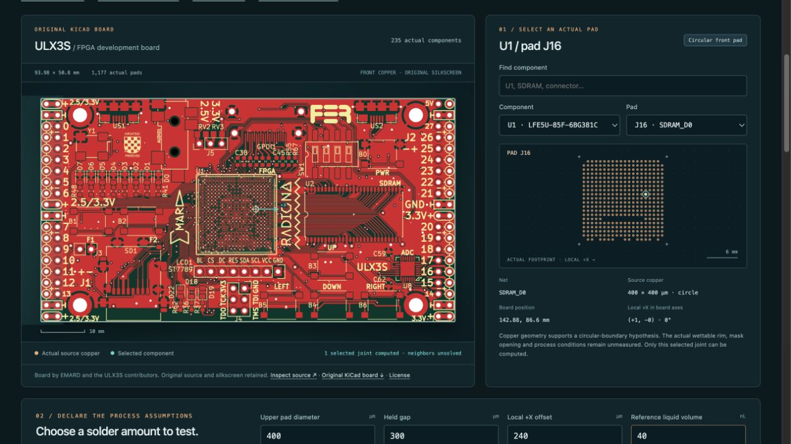

# SolderShape

Would adding solder help this joint? Follow that design question on an actual KiCad pad, change one assumption, and keep the numerical evidence for a matching physical test.

[Website](https://soldershape.steph4n.dev) · [Research release](https://github.com/steph4n-gh/soldershape/releases/tag/v0.4.0-preview.1) · [CI](https://github.com/steph4n-gh/soldershape/actions/workflows/checks.yml)

**Research preview. Physical force accuracy is unqualified.** The full board supplies context. Only the selected isolated joint is calculated.



The example board is ULX3S by EMARD and its contributors. Its original silkscreen and [modified MIT notice](board_demo/source/LICENSE.md) are retained. The board authors do not endorse this solder comparison.

## Run locally

Requirements are Python 3.12 or newer, a C compiler, `make`, and a modern browser. The application uses Python's standard library. Setup downloads and builds the hash-pinned native Surface Evolver engine. Internet access is needed for that first setup.

Clone the public source and run:

```sh
git clone https://github.com/steph4n-gh/soldershape.git
cd soldershape
python3 tools/setup_engine.py
python3 -m soldershape serve --port 8765
```

Open [Board explorer](http://127.0.0.1:8765/board). On macOS, you can also double-click `Start SolderShape.command`. This checkout was exercised on Apple Silicon macOS with Python 3.14 and Apple clang 21. Other systems remain unqualified. A separate Node.js runtime is useful for development checks, not application use. A raw Git clone omits prebuilt lab ZIPs and the handbook PDF. The [complete research-release package](https://github.com/steph4n-gh/soldershape/releases/tag/v0.4.0-preview.1) includes those optional files. The core Board comparison works without them.

[Follow the Board decision walkthrough](docs/getting-started.md). [Watch the 36-second visual walkthrough](docs/media/walkthrough.mp4), assembled from six actual application captures. Each still lasts six seconds. The video has no audio, and its editorial timing does not represent solver speed. A [text transcript](docs/media/README.md) covers the same steps.

## What you can do

- Select a real board pad or import a circular copper SMD pad from a KiCad footprint.
- Compare upper-pad diameter or liquid solder volume under shared conditions.
- Prescribe the gap, or solve the gap under a supported downward load per joint.
- Sweep prescribed offsets and inspect each native mesh, force and numerical status.
- Save input-only cases. Export readable HTML, CSV, OBJ, STL and the native numerical receipts together.
- Plan a pad revision or an outside-lab measurement using the separate study and fixture materials.

## Follow a decision that changes with an assumption

The worked example uses actual ULX3S U1/J16 lower copper, 400 µm in diameter. The opposing pad and process inputs are hypothetical. Choose **Load U1 / J16 worked example** to load the 40 versus 56 nL comparison. The app keeps one prior input snapshot for **Restore my previous inputs**.

At the 300 µm held gap, only 40 nL meets the numerical fixture rule of lateral restoration without upward separation. Choose **Try a 330 µm held gap** to change that input alone and compute both volumes again. At 330 µm, both meet the rule. A freely supported package needs a different weight-support objective.

The result identifies source copper, process assumptions, numerical check status and absent physical qualification. Editing an input clears the prior result and its exports. A verified recording is labeled separately from a fresh native computation. Save the review and board-bound evidence, then use the matching **Physical test** handoff to identify the required measurements.

These two sampled gap hypotheses do not establish manufacturing tolerance, physical force accuracy or a production volume. [Inspect both outcomes and their limits](docs/model-and-validation.md).

## What is established

The application uses the existing Surface Evolver numerical engine. Its contribution is the KiCad-to-comparison-to-evidence workflow. Numerical refinement and replay checks assess consistency. Published physical comparisons include unresolved force discrepancies and model limits. No process-specific accuracy, package self-alignment, bridging, yield or reliability is established.

The [validation reference](docs/model-and-validation.md) separates numerical agreement, published-data comparisons and unperformed physical tests. [Developer checks](docs/development.md) explain how to reproduce the evidence. Engineering reports retain failed cases and historical source identities.

The [current pre-lab investigation](prelab/REPORT.md) tests the separate 220 versus 270 µm height-coupon design under combined input changes and prescribed wetting hypotheses. It retains ranking reversals and finite-pad solver failures. Its declared clearance target is 185 µm. Its [measurement addendum](prelab/LAB_ADDENDUM.md) identifies the observations needed before either design can receive a clearance qualification. That coupon does not validate the 400 µm Board example's forces. The existing 200 µm force fixture also needs adaptation and qualification for this board question.

## Documentation

[Documentation index](docs/README.md) points to the user guide, model reference, CLI and verification commands, and the engineering record. [CONTRIBUTING.md](CONTRIBUTING.md) describes useful contributions. [SECURITY.md](SECURITY.md) describes the local-only runtime boundary and private vulnerability reporting. [Launch readiness](launch/READINESS.md) records the release process and its verification scope.

## License and credit

SolderShape's original code, documentation and project-authored design files use the [MIT license](LICENSE). Third-party material retains its own terms. The bundled KiCad library footprint uses CC-BY-SA 4.0 with an electronic-design exception. ULX3S uses its modified MIT notice. The native engine is downloaded and built locally; its binary and source archive are not redistributed here. See [THIRD_PARTY.md](THIRD_PARTY.md).

The lab and coupon artifacts are test-planning material. Their license does not establish fabrication readiness or physical validation.
