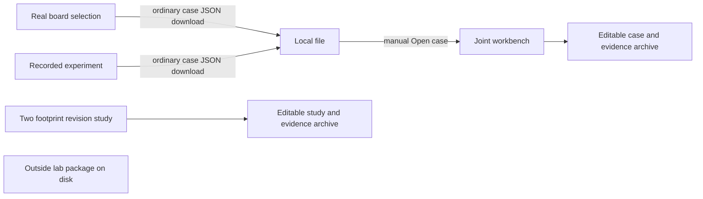

# SolderShape UI grounding

## Overview

The current product has one numerical engine and four independent browser pages. Each page teaches a different starting question. There is no common navigation contract, draft store, or direct handoff. The user's impression of four apps matches the source structure.

The useful outcome today is an explicit, reproducible solder-joint question. A user can identify a circular pad, compare hypothetical solder conditions, inspect a calculated force or gap, and retain inputs and numerical evidence. Physical force accuracy remains unqualified. The UI should help users move from an interesting result to a reviewable question and then a physical test.

## Key concepts

- An editable case is `soldershape.case.v1`. It contains footprint text, selected pad index, parameters, and optional reference upper diameter and volume. `model.parse_case` and `/api/case` normalize it.
- A study is `soldershape.study.v1`. It contains two independent footprint sources, boundary declarations, shared load-controlled parameters, a gap criterion, volume samples, and input evidence. It cannot be silently substituted for a held-gap case.
- A board request is `soldershape.board-request.v1`. It adds trusted board identity and an actual component/pad selection. Its resulting ordinary editable case intentionally contains only footprint geometry and calculation inputs.
- Results and inputs are different data. Every current page correctly clears results and exports after input edits. Restoring an editable draft must never restore a claim that a result matches it.
- Demo and initial board preview are retained native recordings. Fresh computation uses the local engine. Numerical replay checks calculations rather than physical accuracy.

## How it works

`soldershape/__main__.py:137` exposes a same-origin loopback GET allowlist. `/api/bootstrap` supplies a local token, engine status, and an example footprint. POST operations require this token. `/api/solve`, `/api/sweep`, `/api/compare`, `/api/study`, and `/api/board/compare` share one computation lock. A second compute request receives 409.

Each HTML document owns a separate global `$`, `state`, bootstrap, number formatting, notices, file handling, event listeners, CSS, and result rendering. They can share a small navigation/handoff script, but cannot simply load one another's scripts together because the global bindings collide.

The existing handoffs all pass through the filesystem. Board and demo do not navigate to the workbench after download. Study's footer sends users to the workbench but does not carry a selected native result, mesh, or editable case. The lab package has no route or browser entry point.

## Where things live

| Owner | Current responsibility |
| --- | --- |
| `soldershape/web/index.html`, `app.js`, `style.css` | Footprint import, editable case, held gap or supported load, one joint, comparison and offset sweep. |
| `soldershape/web/study.html`, `study.js`, `study.css` | Two footprint revisions, gap criterion, native nominal runs, finite analytical volume samples, decision brief and archive. |
| `soldershape/web/demo.html`, `demo.js`, `demo.css` | Read-only recorded 200 µm force experiment, retained scope warning and failure, selected editable case export. |
| `soldershape/web/board.html`, `board.js`, `board.css` | Real ULX3S board/context selection, selected circular front pad, hypothetical held-gap comparison, native meshes, board-bound evidence export. |
| `soldershape/web/mesh-view.js` | Shared exact mesh surface renderer. Camera handling is still page-specific. |
| `soldershape/model.py` | Footprint parsing and strict case/spec boundary validation. |
| `soldershape/solver.py` | Pinned native engine, numerical checks, refinement, raw receipts. |
| `soldershape/artifacts.py` | Generic case archive, checksums, meshes, result CSV and bounded archive reading. |
| `soldershape/study.py` | Study parsing, analytical baseline, declared criterion, study archive. |
| `soldershape/demo.py` | Recorded stress evidence and shared conditional force screen. |
| `soldershape/board.py` | Trusted source board identity, selected-joint case, board archive and replay verification. |
| `force_lab/README.md`, `RFQ.md`, `PROCEDURE.md`, `ANALYSIS.md` | Separate quote-ready hot microforce experiment. No lab acceptance or physical confirmation. |
| `tests/test_study_http.py`, `tests/test_board.py`, `tests/test_boundaries.py` | HTTP operations, computation lock/auth, geometry binding, archive integrity and source changes. |

## Concrete gaps

1. **Inconsistent navigation.** `index.html:14-20` has no header nav. `study.html:14-15` points the brand to the study and offers only three destinations. `demo.html:16` and `board.html:16` offer four links but use different labels than Study. The same destination is called Joint workbench, Single-joint viewer, or Joint viewer.
2. **No draft continuity.** There are no `sessionStorage`, `localStorage`, `URLSearchParams`, navigation guard, or page lifecycle handlers in `web/`. Following a normal nav link discards current in-memory inputs and results. Workbench bootstrap reloads its unrelated example at `app.js:1002`. Board bootstrap reselects its default at `board.js:287`. Study initializes to a blank form and does not restore a previous draft.
3. **Manual and hidden handoff.** `demo.html:58` tells users to download a JSON and manually choose Open case. `demo.js:372-381` exports the selected case. `board.js:285` does the same. Neither page has an Open in joint workbench action.
4. **Study mesh dead end.** `study.html:100` says to use the single-joint viewer to inspect a mesh or sweep. `study.js:286-315` renders report tables but has no selected-record handoff. A faithful handoff needs the particular arm, mapping and parameters. The equivalent-volume two-pad mapping must remain explicitly labeled because its mesh is not physical solder.
5. **Lab package orphan.** `__main__.py:155-207` exposes no force-lab package, procedure, or lab page. UI copy says plan a physical test, but does not link to the existing deliverable. An allowlisted local package download would complete this next step without creating a new subsystem.
6. **Board engine state differs.** `board.js:54-55` gates Compute on token and selected pad, unlike `app.js:148` and `study.js:56`, which also gate on engine readiness. A recorded preview should remain inspectable without the engine, but Compute should explain an unavailable engine.
7. **No board case reopen.** Board can save an ordinary case but has no Open case. The workbench is the existing reopening owner. Opening the ordinary case there loses board binding unless the origin label explicitly says it is a copied geometric case; keep board-bound evidence separately available on the Board page.

## Minimal reuse proposal

Use a small shared navigation CSS/JS pair or identical static header markup, with one consistent order and labels. Keep existing page algorithms and Python schemas. Make Board the clear guided entry point, and expose Workbench and Study as tools for different questions. Label Demo as a worked example instead of a separate product.

Add a bounded same-origin handoff using the existing `soldershape.case.v1` data shape. Validate the draft through `/api/case` before putting it in a short-lived session handoff. Let the destination explicitly consume it, clear prior results, and show its origin. Do not transmit base64 archives in URLs or automatically claim the copied case remains board-bound.

Preserve editable drafts per page across navigation. Store inputs only, at existing request limits. Restored inputs require fresh computation. If persistence is unavailable or full, show a clear notice and keep manual save available. Never serialize API tokens, raw native receipts, or in-flight response claims into the draft.

Add one lab handoff section or page with the current quote-ready package, exact test geometry, commissioning gates, and explicit gap between the 200 µm fixture and 400 µm board hypothesis. Use a fixed route to the known package rather than an arbitrary file server. A broad redesign, router, bundler, account, or new project framework is not needed.

## Gotchas

- `board.py:16` includes `__main__.py` in `CODE_FILES`. After server route edits, restart the service before fresh board compute/export. `board.py:45-51` compares loaded hashes with files on disk and rejects source changes. A stale running service is not a valid new-code test.
- Historical board recordings should stay immutable. `board.py:238-314` validates archived source hashes against the archive, trusted board extraction, and the stored recording identity. Current UI-only changes need not rewrite those numerical archives.
- `study.py:16-19` captures loaded source hashes for `model.py`, `solver.py`, and `study.py`. Do not change numerical sources just to add UI continuity.
- `/api/study/case` requires a normal-load spec. A Board/Demo held-gap case cannot become a meaningful pad revision study merely by copying numbers.
- All calculation requests are immutable snapshots with revisions. In-flight responses must stay discarded when the user edits inputs, changes pages, or opens another case.
- All scripts use strict global top-level bindings. A shared script needs its own closure or a single namespaced object.
- The server's strict CSP allows same-origin external scripts/styles and blocks inline script. New common chrome should use external assets or static HTML.
- The old 220/270 µm height coupon, the 200 µm stress force experiment, and the 400 µm ULX3S hypothesis are separate scientific contexts. A unified UI must not imply one experiment validates all three.
