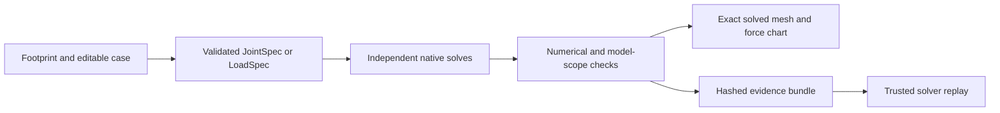

# About an extreme solder alignment demonstration

## Overview

SolderShape already has a stronger demonstration than its nominal pad-height table. The retained fixed-gap experiment makes a conditional design decision that a volume-equivalent cylinder gets wrong. Its solved shapes, force-direction changes, and explicit acceptance rule give an engineer something concrete to inspect.

The current computation represents one molten joint between two fully wetted circular rims. The whole footprint provides pad selection and context. It does not become a coupled package or board simulation. A convincing larger-board presentation must preserve that distinction.

This explanation describes source inspected at base `ffe314f`. It did not run a new native simulation. Recorded numerical values below come from the retained comparison evidence.

## Key concepts

- `JointSpec` stores the two diameters, prescribed wetted-plane gap, solder volume, signed lateral offset, surface tension, density, and gravity setting. `LoadSpec` replaces the prescribed gap with a downward normal load.
- `soldershape.case.v1` stores the original footprint text, selected pad, normalized parameters, and an optional reference. The reference changes upper-pad diameter and volume. Both designs retain the same selected board pad and shared conditions.
- A result combines the normalized input hash, numerical status, forces, equilibrium geometry, triangle mesh, checks, engine identity, and raw engine receipts.
- `refinement_checked` is a numerical classification. It does not establish physical accuracy, global uniqueness, or suitability for manufacture.

## How it works

`model.import_footprint` reads one `.kicad_mod` footprint, not a complete `.kicad_pcb`. It accepts circular SMD copper pads. An explicit negative solder-mask margin makes the pad unsupported because the solver assumes a copper rim. Board mask settings and final CAM remain unresolved. `request_from_footprint` takes the lower diameter from the selected pad, so an independent parameter cannot silently override its geometry.

`__main__.calculate` constructs one request or up to seven independent offset requests. The existing browser requests five offsets at minus the selected magnitude, half that magnitude, zero, half the positive magnitude, and the positive magnitude. Each point has its own solve. `calculate_comparison` solves the reference and candidate under the same selected board pad, gap or load, offset, and material. It returns a force comparison only when both pass numerical checks and have no pad-plane scope warning.

`solver._model` generates a Surface Evolver model in centimeter, gram, and second units. It pins the circular contact rims, fixes volume, and minimizes surface and gravitational energy. The side facets carry surface tension. Fixed caps close the body without adding free-surface energy. Force extraction uses small displacements and pressure-corrected energy differences at fixed target volume.

`_solve_with_levels` relaxes the model and compares successive refinements. A passing result requires volume error at most 0.1 percent, no negative local Hessian eigenvalues, additional energy relaxation at most `1e-7` relative, and force changes at most 1 percent under the declared capillary-scale normalization floor. The exporter also checks tessellated volume within 0.1 percent. `_solve_fixed` tries one additional refinement when the first result fails without negative eigenvalues.

`_mesh` requires finite vertices, nondegenerate facets, consistent directed edges, closed topology, and positive enclosed volume. `_annotate_planes` separately flags a mesh that extends beyond its two wetted pad planes. Those warnings describe missing substrate clearance, not a numerical solver failure. Self-intersections remain explicitly unchecked.

The browser's `drawModel` projects the returned mesh vertices and triangles directly. It offers rotation, zoom, mesh edges, pad outlines, and a scale bar. `drawChart` plots the separately solved force points. Clicking a result changes which computed mesh appears. A line between chart samples is visual interpolation, not another equilibrium calculation. Any animated passage between meshes would need the same clear label. Input revision checks discard obsolete asynchronous results and clear their downloads.

`artifacts.make_bundle` packages normalized inputs, CSV, original footprint, editable case, optional comparison, result JSON, OBJ, STL, generated Evolver model, commands, and captured output. SHA-256 hashes bind each member to the manifest. `read_bundle` verifies member integrity and normalized input identity. The `replay` command runs the trusted installed solver again. It reports numerical agreement separately from exact engine source and binary agreement. Archived commands never execute during replay.

## Existing decision evidence

`examples/design-comparison.json` fixes a 0.4 mm pitch context, equal 0.2 mm pad diameters, 0.15 mm prescribed gap, and 0.02 mm lateral offset. It compares nominal volumes of 0.005, 0.006, and 0.007 mm³ at five illustrative volume factors each. Three nominal controls disable gravity. This is 18 recorded scenarios, with a repeated input in the initial volume samples.

The declared rule requires lateral restoration, no upward separating force, and a mesh inside the pad's pitch cell at every sampled volume. The retained report selects 0.005 mm³. The other candidates develop upward force within their tested ranges. The volume-equivalent cylinder selects 0.007 mm³ because it changes effective radius rather than preserving the pinned pad boundary. Disabling gravity does not remove the nominal axial-sign disagreement. The prior sign information was already known, so the protocol explicitly disclaims blind discovery.

This result is a useful story about boundary conditions and a conditional decision. It is not a qualified production volume recommendation. The pitch-cell screen checks a single mesh against an axis-aligned cell. It does not simulate adjacent joints or detect a solder bridge.

## Two grounded opportunities

1. Build a force-direction demonstration around the existing 0.4 mm footprint and retained three-volume evidence. Show the actual solved shape beside the cylinder approximation, then expose the volume sample that changes axial sign. Make the engineer's declared separating-load rule visible. Reuse the existing meshes, bundles, envelope calculation, and editable winning case. This is the smallest credible path to an immediate demonstration with a surprising decision.
2. Build an offset stress demonstration on the same geometry. Independently solve a bounded set of lateral offsets and show where restoration, convergence, pad-plane scope, or cell clearance fails. Use exact solved meshes at each sample, including failed points. A board rendering can locate that representative joint and display neighboring pitch cells. It must not imply that all depicted joints were solved together or that the tool predicts alignment time or placement yield.

The second opportunity still needs new numerical evidence. Increasing the offset to the input limit would test an arbitrary software bound rather than an engineering condition. Declare pitch-relative offsets and stop conditions first. Preserve every failed sample.

## Where things live

- `soldershape/model.py` owns request types, KiCad parsing, numeric limits, and editable-case validation.
- `soldershape/solver.py` owns generated native models, force extraction, refinement, loaded-height checks, mesh checks, and raw receipts.
- `soldershape/__main__.py` owns local endpoints, independent sweeps, reference comparison, CLI runs, and trusted replay.
- `soldershape/artifacts.py` owns CSV, OBJ, STL, ZIP manifests, and bundle validation.
- `soldershape/web/app.js` owns the exact-mesh canvas, camera controls, force chart, result selection, and stale-result behavior.
- `tools/compare_designs.py` owns the retained comparison runner, cylinder baseline, pitch-cell envelope, receipt reuse, and candidate decision.
- `evidence/design-comparison/report.md` and `comparison.json` own the recorded result and its limitations. The supplied replay command names the historical solver hash and cannot be assumed to describe the current source identity.

## Gotchas

Input limits permit diameters from 0.05 to 10 mm, gaps from 0.02 to 10 mm, volume from `1e-6` to 1000 mm³, and offsets from minus 5 to 5 mm. Those are parser bounds, not a physically qualified operating domain. The native process has time, output, and mesh size limits. Difficult geometry may fail before yielding a checked result.

An equilibrium sweep contains independent locally stable solutions. It does not simulate a moving package. The solver omits wetting dynamics, contact-angle hysteresis, flux chemistry, thermal reflow, material solidification, mechanical obstacles, and package coupling. Stronger predicted restoring force cannot establish faster or more reliable self-alignment. A dramatic board image must keep those limits next to the claimed result.
