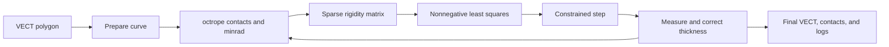

# KnotForge feasibility

## Overview

KnotForge has a credible numerical foundation, but its maker value is less established than its mathematical value. Ridgerunner already computes constrained local tightenings of polygonal knots. A web interface could make its contact, curvature, and convergence diagnostics accessible. A language port adds no demonstrated capability by itself.

For sculpture or jewelry, KnotPlot is a strong practical alternative. Its current distribution supports Apple Silicon, editable knot geometry, a large knot library, and OBJ and DXF surface exports. An optimizer becomes useful when a designer specifically needs a compact thick-tube shape and can tolerate local minima. There is no customer evidence in this investigation that this is a frequent paid need.

The honest first version would wrap the upstream executable locally. It would load one closed polygonal component, tighten a bounded low-resolution run, display measured constraints and stopping reason, and export a tube at a radius strictly below measured thickness. A Rust or WASM rewrite is premature before that workflow earns user demand.

## Key concepts

- `plCurve` stores polygonal components, vertices, constraints, and symmetry metadata. It comes from the separate plCurve library.
- `octrope` finds short self-contact struts and minimum-radius locations. Thickness combines self-contact distance and local curvature.
- `search_state` records the run, tolerances, minimum radius, thickness, length, residual, active contacts, and stopping conditions.
- A strut is an active self-contact constraint between two positions on the polygon. A minrad constraint limits local bending.
- `taucs_ccs_matrix` stores the sparse rigidity matrix. Each column describes the vertex forces associated with an active constraint.
- The residual describes how much shortening force remains after balancing against nonnegative constraint forces. A small residual is a local first-order condition, not a proof of the shortest knot.

## How it works

`src/ridgerunner_main.c` parses VECT input and options, prepares the polygon, and initializes `search_state`. Autoscaling lifts the starting curve away from exact self-contact. Optional resampling and equilateralization reduce poorly spaced edges.

`bsearch_stepper` in `src/stepper.c` owns the iteration and stopping conditions. `inputForce` constructs the shortening force. `resolveForce` calls `buildRigidityMatrix`, which asks octrope for active contacts and curvature constraints. It then calls `t_snnls_fallback` to find nonnegative constraint forces that best balance the shortening force. The remaining force supplies the constrained descent direction.

The stepper limits the motion and measures thickness again. Accumulated violations trigger `correct_thickness`, which uses a Newton-style correction. Some failed corrections recover by scaling when positional constraints allow it. Runs can stop on a step limit, elapsed time, small residual, or inadequate progress. Logs and final geometry carry the actual stopping reason.

The numerical work lives across multiple C libraries. The main repository has 8,241 lines across `src/*.c`, including 4,373 lines in `stepper.c`. The baseline requires plCurve, tsnnls, argtable2, GSL, OpenBLAS, and ncurses. A faithful port must reproduce contact detection, minrad gradients, sparse nonnegative least squares, finite-step error control, and correction behavior. Replacing this with a visual spring simulation would change the product's central claim.

## Where things live

- `ridgerunner/src/ridgerunner_main.c` loads geometry and configures the run.
- `ridgerunner/src/stepper.c` owns `resolveForce`, `buildRigidityMatrix`, `placeContactStruts`, `placeMinradStruts`, `correct_thickness`, and the stepper.
- `ridgerunner/src/ridgerunner.h` defines `search_state` and diagnostics.
- `ridgerunner/tools/residual.c` evaluates a stored curve's residual and constraints.
- `ridgerunner/test/` has gradient and correction checks.
- `ridgerunner/data/3.1.vect` is the bundled loose trefoil. `4.1.vect` is a figure-eight starting case.
- `libplcurve-11.2.2/src/octrope.c` defines thickness and ropelength. Its implementation divides total length by `min(min_strutlength/2, min_rad/lambda)`.

## Gotchas

The upstream author warns that degenerate contact systems can stop the linear algebra. A Hopf link made of two exact circles is a documented bad start. Symmetry and many simultaneous initial contacts need deliberate handling. These are documented risks, not failures reproduced in this investigation.

The README recommends low resolution first, followed by staged increases. Its stated breakdown near resolution 40 is an upstream observation, not a measured limit on this machine. Accepted individual steps can increase ropelength because the stepper trades finite constraint error against progress.

Tube mesh validity needs separate verification. Tight contact creates tangencies, which can produce a mesh unsuitable for printing despite valid centerline constraints. A usable exporter needs finite coordinates, nonzero triangle areas, consistent orientation, two faces per edge, a closed genus-one surface for a single component, positive volume, self-intersection checks, explicit units, and a clearance margin. Geometric validity still does not prove a printer can fabricate the object.

Numerical agreement with upstream would qualify a software implementation. It would not validate friction, material stiffness, bending energy, knot holding strength, or physical rope behavior. No global-optimum claim is justified.

## Source and license provenance

Inspected upstream commit `4ee3199e737dcd3580d8bfc5deb031cd53f5f554`, committed July 1, 2026. It declares package version 2.3.1.

`COPYING` and `COPYING.txt` contain GPL version 3. Core headers and `stepper.c` explicitly grant GPL version 3 or later. There are conflicting metadata remnants. `configure.ac` says version 2.1 or later, while the current Homebrew formula labels GPL-1.0-or-later. The source-level grant is the strongest inspected evidence for the core code. Do not infer a permissive license from package metadata. Bundled data are described as the KnotPlot library in `Makefile.am`; the individual VECT files have no license headers. Data redistribution provenance needs review before packaging those examples in a product.

Pinned source archives and SHA-256 values are:

| Archive | SHA-256 |
| --- | --- |
| `ridgerunner-2.3.1.tar.gz` | `533e61c7b5897ffeedf67140f2cb400de99aea0b8206e6a818dac2ebdb707bd3` |
| `libplcurve-11.2.2.tar.gz` | `bccb193f8b0ed5f087e02bbd0d83a4b7ca20a61a8a013ce9efb624f0eebca294` |
| `libtsnnls-2.5.1.tar.gz` | `bba757711d5b25ce67f1d49781ca3309d02b540e7b6907edc02f88bdff8e0b67` |

The downloaded Ridgerunner archive matches the published formula's hash. `COPYING` hashes to `3972dc9744f6499f0f9b2dbf76696f2ae7ad8af9b23dde66d6af86c9dfb36986`. The trefoil input hashes to `809cdd9141ee4f118e01301648d7b47daf9a2d7c7683ba42e0f424e50e6405a1`. The figure-eight input hashes to `e7fda6292dc3ae725b914dcacb2aa86aa7f55a5ba0157279e7382e4ec484b04c`.

## Experiment results

The native checkout bootstrap fails because `autoreconf` is absent. The release archive includes generated configure files, so it reaches the numerical dependency check and fails because pkg-config cannot find OpenBLAS. Both logs are preserved as `bootstrap.log` and `configure.log`. This is an environment result, not an algorithm failure.

An isolated Ubuntu 24.04 build attempts the pinned releases without installing dependencies on macOS. Its individual bootstrap, configure, build, and test logs live beside this report. `build-baseline.sh` records its command sequence. The final experiment status is recorded in `EXPERIMENT.md`.

## Investment judgment

KnotForge deserves a bounded interface experiment if a maker can name a design decision that the constrained optimizer improves. It does not yet justify a full Rust or WASM port. The strongest case for it is a visual, accessible tool with rigorous diagnostics and reproducible geometry. The strongest case against it is that mature export tools already satisfy the obvious maker workflow, while the differentiator serves a narrower mathematical audience.

Evidence that would reverse a preference for SolderShape is a designer completing an otherwise difficult compact-knot design, followed by a valid sliced export, using contact and curvature controls that existing tools cannot provide conveniently. A short user-observed comparison with KnotPlot would be more decisive than a polished renderer.

## Primary sources

- [Ridgerunner project and author notes](https://jasoncantarella.com/wordpress/software/ridgerunner/).
- [Ridgerunner source](https://github.com/designbynumbers/ridgerunner).
- [Pinned Ridgerunner release](https://github.com/designbynumbers/ridgerunner/releases/tag/v2.3.1).
- [Knot tightening by constrained gradient descent](https://jasoncantarella.com/downloads/papers/rrpaper/ridgerunner.pdf).
- [Homebrew Ridgerunner formula](https://github.com/designbynumbers/homebrew-cantarellalab/blob/main/ridgerunner.rb).
- [plCurve source](https://github.com/designbynumbers/plcurve).
- [tsnnls source](https://github.com/designbynumbers/tsnnls).
- [KnotPlot current download and supported platforms](https://knotplot.com/download/).
- [KnotPlot surface export reference](https://knotplot.com/manual/ExportingModels.html).
- [Knoodle source](https://github.com/HenrikSchumacher/Knoodle). Its documented focus is diagram simplification, identification, and self-avoiding polygon sampling. It is not an inspected replacement for Ridgerunner's tightening objective.
