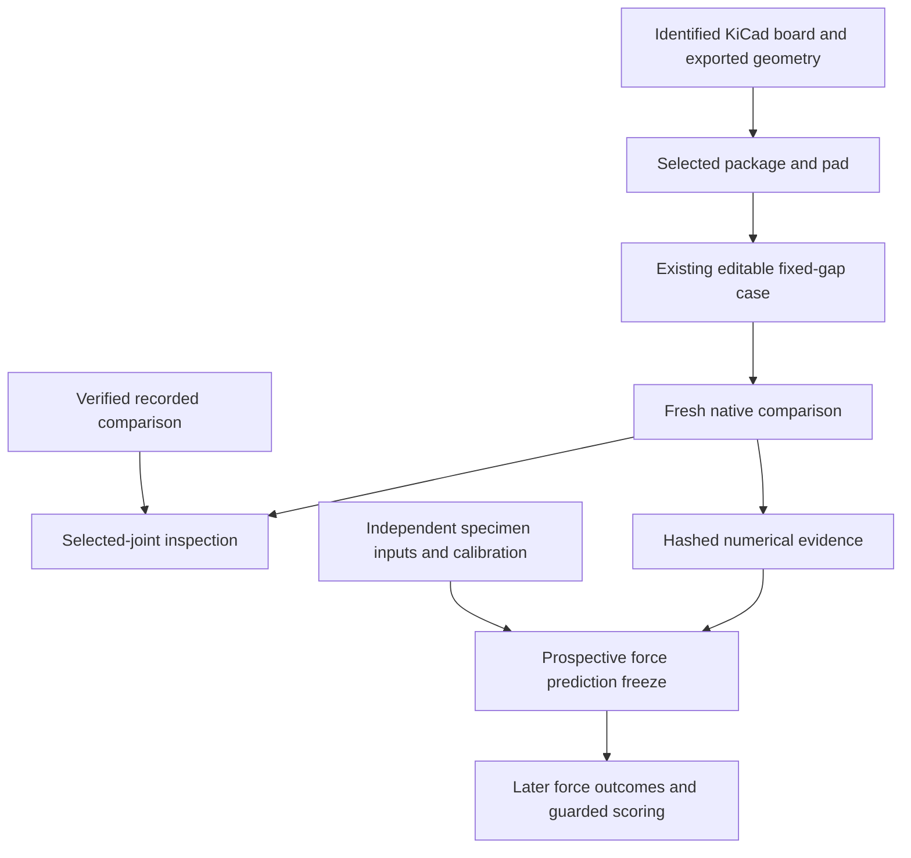

# About extending SolderShape into a force experiment and board study

## Overview

The current application already computes the fixture-held problem the new experiment must test. Its reusable unit is one identified circular pad, one immutable joint request, and one native result with exact geometry and raw evidence. A board can locate those units. It cannot turn them into a coupled assembly calculation.

This explanation inspected current source at base `65b9839`. It ran no native computation and changed no application files. The retained stress recording supplies the numerical examples. A separate force-experiment protocol and a board-context record are the smallest missing data structures. The existing solver, case format, local server, mesh renderer, and numerical archives remain useful.

## Key concepts

`JointSpec` fixes the lower and upper circular rim diameters, wetted-plane gap, liquid volume, signed lateral offset, surface tension, density, and gravity. `LoadSpec` fixes a downward load instead of gap. Both are immutable and hash their normalized numeric inputs. The matching force fixture needs `JointSpec`. A compliant fixture must measure and maintain the actual gap and offset rather than silently becoming a load-controlled experiment.

`soldershape.case.v1` identifies one original footprint and selected pad. It stores shared parameters and an optional reference that changes upper-pad diameter or volume. This already expresses the 5 versus 7 nL fixed-gap comparison. The lower diameter always comes from the selected source pad.

A result keeps numerical status separate from `model_warnings`. A checked native equilibrium can still exceed the wetted planes because substrate obstacles are absent. A failed case retains receipts without a successful mesh. A result's engine identity and normalized input identity do not establish physical accuracy.

The new force experiment needs specimen identities, run blocks, independent metrology inputs, calibration identity, and separately recorded force outcomes. The new board context needs a source-board identity, actual package and pad coordinates, a selected footprint identity, and an explicit mapping into a case. Neither concept belongs in `JointSpec`.

## How it works

### The existing fixed-gap chain already matches the scientific question

[`request_from_footprint()`](/Volumes/Storage/oct16project/soldershape/model.py:237) imports one `.kicad_mod` and derives the lower diameter from its selected copper pad. Circular SMD pads are supported. Other shapes and known smaller mask openings are rejected. Footprint mask settings are partly read, but board-level rules, drawn mask artwork, final CAM, finish, and actual wetting remain unresolved.

[`calculate()`](/Volumes/Storage/oct16project/soldershape/__main__.py:33) normalizes each request and calls `solve()`. It converts a native exception into a failed result with its evidence. [`calculate_comparison()`](/Volumes/Storage/oct16project/soldershape/__main__.py:53) computes both arms afresh with the same board pad, gap, offset, and material. It permits force deltas only when both results pass numerical checks and have no detected pad-plane excursion.

[`solver._model()`](/Volumes/Storage/oct16project/soldershape/solver.py:46) creates the pinned-rim Surface Evolver model in cgs units. It fixes liquid volume and minimizes surface and gravitational energy. The fixed end caps close the volume without adding free-surface energy. Small virtual displacements and pressure-corrected energy differences produce forces on the upper pad. Positive lateral force acts along positive local x. Positive vertical force acts upward.

[`_solve_with_levels()`](/Volumes/Storage/oct16project/soldershape/solver.py:204) checks force refinement, volume residual, additional energy relaxation, local Hessian modes, and tessellation volume. `_solve_fixed()` allows one bounded extra refinement. `_mesh()` checks finite, nondegenerate, closed, consistently oriented geometry. `_annotate_planes()` adds a separate warning when sampled vertices cross either wetted plane. Numerical thresholds are engineering checks, not measurement uncertainty intervals or proof of a unique global equilibrium.

The model has no temperature input. Temperature-dependent surface tension, liquid density, thermal geometry, and their uncertainty must enter as independently justified experiment inputs. The current material defaults of 0.48 N/m and 9 g/cm3 are planning values. They do not identify a real alloy or process.

### The retained stress recording is a baseline, not a prospective physical freeze

[`demo/protocol.json`](/Volumes/Storage/oct16project/demo/protocol.json) fixes seven independent requests. At 120 micrometers of offset, the retained 5 nL case gives approximately -92.263 micronewtons laterally and -89.981 micronewtons vertically. The 7 nL case gives approximately -82.193 and +7.619 micronewtons. Those are computed forces at 200 micrometer rims and a 150 micrometer held gap. They identify the lateral difference and small upward sign the metrology must discriminate.

[`read_demo()`](/Volumes/Storage/oct16project/soldershape/demo.py:60) verifies the exact archive, protocol, archived calculation source, normalized requests, and selected footprint before exposing results. [`screen_pair()`](/Volumes/Storage/oct16project/soldershape/demo.py:27) computes the conditional objective from both results. It blocks a preference when either result fails or either has a scope warning. The 200 micrometer comparison and compressed-gap failure remain distinct negative controls.

The existing demo is recorded. Its browser exports an editable case for fresh computation in the original workbench. [`tools/build_demo.py`](/Volumes/Storage/oct16project/tools/build_demo.py) records fresh native results and refuses changed numerical source during the run. [`tools/verify_demo.py`](/Volumes/Storage/oct16project/tools/verify_demo.py) replays successful forces and matches the retained failure's native error signature. A generic replay cannot count an expected failed computation as a successful solve.

The new force protocol can reference this baseline without overwriting it. Confirmatory predictions must use independently measured physical inputs frozen before force outcomes. A timestamp and hashes preserve supplied bytes. They do not prove that no investigator previously saw outcomes.

### The height-study and coupon code provide patterns with different scientific scope

[`read_study()`](/Volumes/Storage/oct16project/soldershape/study.py:63) supports two independently identified lower footprints, but it requires `LoadSpec`. Its objective is pad-face gap. Its finite volume screening uses the aligned Eq. 9 approximation and a conservative compression policy. This schema does not express the fixed-gap lateral-force experiment. Adding a force branch would mix two distinct decisions.

The study exporter does provide a reusable example of composing a richer report around `make_bundle()`. It adds normalized study inputs, a generated report, original footprint sources, calculation-source hashes, and an updated manifest. Replay reconstructs the report and requests before fresh native computation. It labels numerical equivalence separately from exact engine and calculation-source agreement.

[`coupons/tools/analyze.py`](/Volumes/Storage/oct16project/coupons/tools/analyze.py) is a separate cap-height experiment. `freeze(inputs, metadata, output)` captures exact inputs, experiment, and allocation bytes. It predicts native results before later observations and rejects changed calculation code. `frozen_snapshot(directory)` captures verified frozen files once. `score(directory, outcomes, output)` parses and hashes the same outcome bytes and preserves missing specimens in the denominator.

Its scientific constants are specific to twenty-joint caps, pad-height mappings, gap tolerances, wetting counts, and three reflow runs. Reuse the exact-byte freeze and prospective separation pattern. Keep the new force scorer separate rather than modifying this historical experiment. The force scorer needs independent axis uncertainties, calibrations, cross-talk, thermal drift, and displacement consistency that the height scorer does not represent.

### A board needs identified context around existing cases

The importer explicitly rejects a complete `.kicad_pcb`. It handles at most 4096 pads within one 2 MB footprint. The existing demo renders one 36-pad footprint and one highlighted joint. Neither provides a complete-board parser.

A purpose-designed KiCad board and deterministic export can supply real package references, pad identifiers, local coordinates, board coordinates, rotations, and unsupported geometry. A compact board manifest can retain the source-board hash and exact selected footprint text. The selected footprint and pad then produce the existing editable case. Local lateral x must remain explicit when a package rotates on the board.

The browser can inspect recorded evidence immediately and submit the selected case to the existing compare endpoint for fresh computation. Any changed package, pad, gap, volume, or offset must invalidate the previous result and export. The original workbench and study page already use revision counters to discard obsolete asynchronous responses.

[`mesh-view.js`](/Volumes/Storage/oct16project/soldershape/web/mesh-view.js) draws the actual native vertices and triangles. The new board page can reuse it for the selected joint. Repeated pad outlines are legitimate board context. Repeated copies of one mesh remain repeated illustrative geometry, and cannot establish that other joints were computed.

## Where things live

| Owner | Existing entry point | Smallest extension responsibility |
| --- | --- | --- |
| [model.py](/Volumes/Storage/oct16project/soldershape/model.py) | `JointSpec`, `request_from_footprint(source, pad_index, parameters)`, `parse_case(data)` | Preserve current single-joint physics and lower-pad provenance. |
| [solver.py](/Volumes/Storage/oct16project/soldershape/solver.py) | `solve(spec)` | Reuse for physical-input central predictions and declared sensitivities. No new board solver is required. |
| [__main__.py](/Volumes/Storage/oct16project/soldershape/__main__.py) | `calculate_comparison(case)`, `Server`, `Handler` | Add the board page and identified context endpoint. Reuse the token, same-origin checks, and computation lock. |
| [artifacts.py](/Volumes/Storage/oct16project/soldershape/artifacts.py) | `make_bundle(results, source, editable_case, comparison)`, `read_bundle(path)` | Wrap selected-case evidence with verified board context when required. Keep trusted replay. |
| [demo.py](/Volumes/Storage/oct16project/soldershape/demo.py) | `read_demo()`, `screen_pair(reference, candidate)` | Reuse checked recorded data and the scoped force objective without changing the retained protocol. |
| [study.py](/Volumes/Storage/oct16project/soldershape/study.py) | `run_study(data)`, `bundle_study(report)`, `replay_study(path)` | Use as an identified-report composition example. Preserve its loaded-height contract. |
| [build_boards.py](/Volumes/Storage/oct16project/coupons/tools/build_boards.py) | `generate(spec)` | Copy the pinned KiCad generation and export approach into the new artifact owner. Preserve old coupon paths. |
| [verify_boards.py](/Volumes/Storage/oct16project/coupons/tools/verify_boards.py) | `main()`, Gerber and geometry checks | Use the actual native board, DRC, and Gerber cross-check pattern for new geometry. |
| [package_lab.py](/Volumes/Storage/oct16project/coupons/tools/package_lab.py) | `build(output)`, `verify(path)` | Use the explicit file-set and digest manifest pattern in a separately named force package. Preserve original artifacts. |

## Gotchas

The numerical bundle reader accepts one through seven cases, at most 100 members, 40 MB compressed, and 160 MB uncompressed. A whole board does not require a whole-board solved archive. Keep one selected comparison or a small declared set per replayable numerical bundle. The board source and manufacturing package can use a separately identified context archive.

The current native mesh is the free liquid domain between ideal rims. Pad sidewalls, contact-angle hysteresis, flux or oxide chemistry, thermal transients, probe wetting, neighboring joints, package tilt, and substrate contact are absent. A sensor or stalk that changes the actual wetted boundary changes the experiment. A CAD match in nominal diameter alone cannot establish model equivalence.

The existing physical force-validation failure remains unresolved. A polished board page, better precision display, or fresh native replay does not repair that physical result. The new experiment is useful because it can independently reject the model or delimit where it agrees.

Laziness Protocol shaped the recommendation to reuse the fixed-gap case, solver, and renderer. Model the Domain shaped the separate records for board identity and prospective force observations. Both choices avoid adding board or experiment state to the numerical request.
