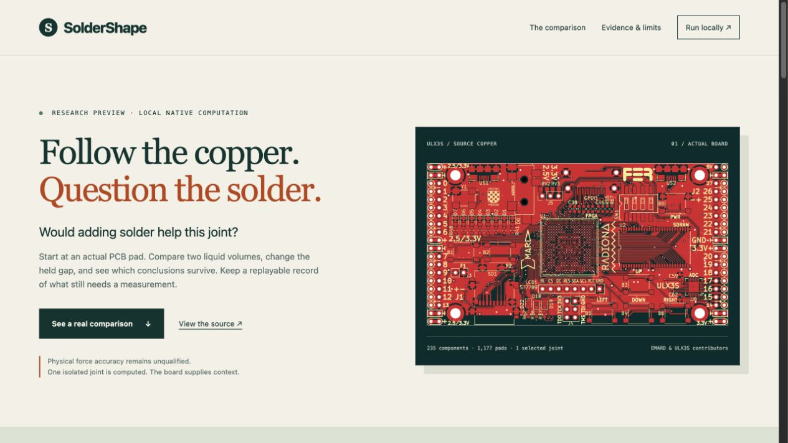

# Public research preview

SolderShape launched on 2026-10-17. The public preview is at [soldershape.steph4n.dev](https://soldershape.steph4n.dev). Its [source repository](https://github.com/steph4n-gh/soldershape), [research prerelease](https://github.com/steph4n-gh/soldershape/releases/tag/v0.4.0-preview.1) and [private vulnerability reporting form](https://github.com/steph4n-gh/soldershape/security/advisories/new) are available.

The website presents the recorded Board decision, its assumptions and downloadable numerical evidence. Fresh computations run in the local application. Physical force accuracy remains unqualified. This launch does not establish manufacturing tolerance, yield, bridging, package self-alignment or reliability.

## Published identities

| Artifact | Identity |
| --- | --- |
| Research source and annotated tag | `ecac5fc41c136a878d2f34ed6673d54d5e0a341f`, `v0.4.0-preview.1` |
| Source CI | [Main run 39049361888](https://github.com/steph4n-gh/soldershape/actions/runs/39049361888), succeeded |
| Tag CI | [Tag run 39049561478](https://github.com/steph4n-gh/soldershape/actions/runs/39049561478), succeeded on the same source |
| Sites source | `e00393660155e4bebd364c5e238c49c6ae50ec53` |
| Saved Site | Version 3, `appgprj_6ad2e53e69d4819198ce8a1bc6913741~appgver_feeab9caad188191a06ebccfd28ae885` |
| Public deployment | `appgdep_6ad3a2bcc33c8191aa7b31d768245b4b`, succeeded |
| Site audience | Public, access revision 2 |

These identities describe separate artifacts. The subsequent main-branch publication record adds receipts and a deployment checker; it does not replace the release source, tag, package or Site. The preceding local qualification remains in [launch synchronization](../launch_sync/RESULTS.md). Numerical algorithms and retained physical comparisons were unchanged during publication.

## Repository and security

GitHub API readback confirmed the authenticated `steph4n-gh` owner, public visibility, `main`, and enabled issues. History was pushed without rewriting it. GitHub private vulnerability reporting was enabled before the initial source push and [read back as enabled after launch](evidence/private-reporting-final.json). `SECURITY.md` points to the actual private form and describes the local runtime boundary without promising a response SLA.

The [hosted workflow](https://github.com/steph4n-gh/soldershape/actions/workflows/checks.yml) runs portable boundary and case checks, pre-lab input and finite-pad checks, the offline two-gap walkthrough verifier, Python compilation and JavaScript syntax checks. Action dependencies are pinned by full commit hash; workflow permissions are read-only. Hosted Ubuntu checks do not qualify the native engine on Linux or physical accuracy.

The earlier full-history and archive scans remain in `launch_sync/evidence/history-scan.json`. Publication source and final receipt changes were checked with Gitleaks before their pushes. Third-party notices remain separate from the original material's MIT license.

## Release verification

The complete package is `soldershape-research-candidate-ecac5fc41c13.tar.gz`, 423,695,221 bytes, SHA-256 `844f6dbd00c0f191ed17e6f7a70172e43003f38a7556171f502b4ec498688b4a`.

- All 1,502 manifest members matched in a fresh extraction. No Git metadata, native engine binary or upstream C source archive was included.
- The package includes the two noticed lab ZIPs and handbook PDF omitted from a raw source clone. Both lab ZIPs are also separate release downloads.
- The fresh extraction passed 41 portable tests. Its engine was downloaded and built from pinned official sources. Replaying both retained 330 µm rows produced zero force difference with exact engine provenance. This establishes numerical equivalence, not physical validation.
- All four GitHub asset digests matched the uploaded files. An anonymous download of the full 423 MB package matched its byte count and SHA-256.

See the [manifest receipt](evidence/release-manifest.json), [native replay](evidence/release-board-replay.json), [asset comparison](evidence/release-assets-check.json) and [anonymous download](evidence/anonymous-release-download.json). The GitHub release is a published prerelease, not a draft or a production accuracy claim. Preserved research archives make this repository and package large; GitHub accepted the push with large-file warnings.

## Public website verification

All 108 canonical static files were fetched anonymously from the custom domain. The checker sent no authentication or cookies. The 101 non-HTML responses matched their canonical bytes directly. Seven HTML responses contained one Cloudflare managed JS-detection insertion. The checker permits only that complete hash-pinned script, with its ray identifier and timestamp normalized; every remaining byte must match. An independent reviewer matched all canonical hashes and ran seven controls, including rejection of changed product content, changed provider code, an unrelated script and duplicate provider scripts.

The actual public browser also demonstrated:

- All four recorded choices, their force signs, the matching evidence links and correct held-gap rule. At 300 µm the 56 nL candidate pushes upward; at 330 µm both volumes meet the declared numerical rule.
- A 390 px viewport without horizontal overflow, while retaining the selected 330 µm candidate and its evidence link.
- The local setup guide with the actual public source and release links.
- A downloaded evidence ZIP identical to the maintained example, including both native scenarios and their source bindings.
- The 36-second walkthrough playing to its end with captions enabled and no media error.

The [public-file receipt](evidence/public-files.json), [browser choices](evidence/public-browser-controls.json), [mobile layout](evidence/public-mobile.json), [actual browser download check](evidence/public-download-check.json), [completed video playback](evidence/public-video-playback.json) and [independent review](live-review.md) retain the evidence. The [final check](evidence/final-check.json) joins the publication identities and checks.



## Preserved failures and limits

The first deployment retained owner-private access. Changing the audience alone left the custom domain returning 401 while the generated hostname returned 200. Republishing the same saved version through the public deployment operation resolved that state. The initial failed access receipt is retained in [access-initial-failure.json](evidence/access-initial-failure.json).

Cloudflare rejects the default Python User-Agent with error 1010. The honest `SolderShape-publication-check/1.0` User-Agent and ordinary browser succeeded without credentials or a bypass token. The public checks establish access for those clients, not every HTTP client. Raw HTML hashes initially differed because of the provider insertion; [that negative receipt](evidence/public-http.json) and the [exact difference](evidence/public-html-difference.json) are retained. The verifier follows normal redirects and uses Python assertions; run it without `-O`.

No new physical specimen was measured. Native replay was exercised on Apple Silicon macOS. The two held-gap examples are sampled hypotheses, not process tolerance bounds. The separate 220 versus 270 µm height coupon retains wetting-related ranking reversals and solver failures. The existing 200 µm force fixture needs adaptation and qualification for the Board example's 400 µm pad. The lab materials remain test plans rather than fabrication or physical-accuracy approval.

## Reproduce

For the exact release, extract the complete research package or clone the source at its tag:

```sh
git clone --branch v0.4.0-preview.1 https://github.com/steph4n-gh/soldershape.git
cd soldershape
python3 tools/setup_engine.py
python3 -m soldershape serve --port 8765
```

Open `http://127.0.0.1:8765/board`. The source clone omits optional prebuilt lab downloads; the complete release package includes them. The [development guide](../docs/development.md) gives the numerical and boundary checks.

From current `main`, verify the published static files with:

```sh
python3 publication/verify_public_site.py
```

This checks the current canonical static directory and writes `publication/evidence/public-files.json`. A future website revision needs its own publication identity and receipt.

Prove It Works required exact CI, release downloads, deployed bytes and actual browser behavior. Laziness Protocol kept the existing native application and Sites project. No hosted solver or new hosting stack was added.
