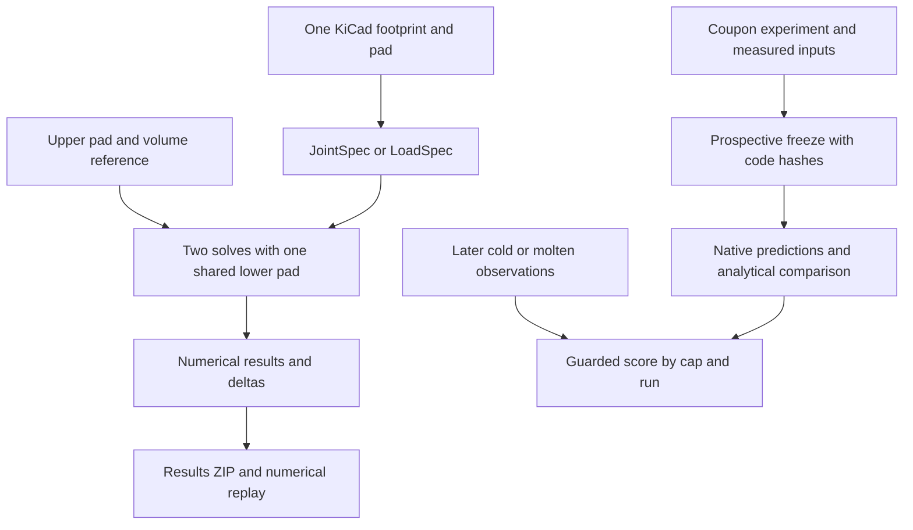

# Architecture of a defensible design comparison

## Overview

This explanation inspects commit `f2cfd9b21da04b49f0512506964d34c31abbcf54`. SolderShape currently turns one selected KiCad copper pad into an isolated equilibrium calculation. It preserves the normalized inputs, numerical checks, generated Surface Evolver program, raw output, and export mesh. A reviewer can inspect the result and recompute it without executing archived programs.

The public comparison workflow covers changes to upper-pad diameter and solder volume. It cannot express the project's proposed 220 versus 270 micrometer board-pad decision. The physical coupon workflow covers that decision in a separate command-line program. It has prospective inputs, measured outcomes, and guarded decisions that the browser does not understand. The strongest refinement opportunity is to connect these existing capabilities through an explicit two-design comparison. Adding another solver or a general project framework would not close this gap.

## Key concepts

- `JointSpec` describes circular lower and upper rims, prescribed gap, liquid volume, prescribed lateral offset, surface tension, density, and gravity. Its immutable fields determine its input hash.
- `LoadSpec` replaces the prescribed gap with a supported downward normal load. The solver computes a gap and independently checks its force balance.
- `soldershape.case.v1` contains one footprint, one pad index, shared parameters, and an optional reference. The reference stores only upper-pad diameter and volume.
- A result has a numerical status. `refinement_checked` means the computation passed declared numerical checks. Separate `model_warnings` identify sampled geometry outside the pad planes. Neither means physical accuracy.
- A results ZIP contains individual computations and their evidence. An editable case contains inputs that require fresh computation when reopened.
- A coupon freeze binds 24 allocated cap specimens to measured inputs, material sources, code hashes, native receipts, and a timestamp. A separate score file assesses later observations.

The word "reference" currently covers different ideas. The browser reference is a saved design variant. Upstream reference cases test numerical reproduction. Published observations test physical agreement. These roles need distinct labels whenever they appear together.

## How it works

### The workbench derives one rim from one footprint

`model.import_footprint()` parses a complete `.kicad_mod` footprint, assigns each pad an array index, and records the source hash. Only circular SMD copper pads are supported. `request_from_footprint()` takes the lower diameter from the selected pad and rejects a user-supplied override. That rule protects provenance for a single calculation.

The import does not resolve an assembled joint's actual wetting boundary. Pad mask margins and other attributes enter the parser's `attrs` dictionary but do not enter the supported-pad decision or the returned geometry. Board-wide mask rules, mask artwork, traces, finish, and package load sharing are also outside this footprint-only input.

A concrete probe imported 0.270 mm circular copper with `solder_mask_margin -0.025`. The importer returned `supported=true` and a modeled lower diameter of 0.270 mm. The declared opening diameter is 0.220 mm. That result demonstrates an accuracy risk at the import boundary. The footprint's copper outline cannot establish that solder wets a pinned rim at that outline.

### Solving and checking remain separate operations

`__main__.calculate()` normalizes a footprint request and calls `solver.solve()` for each requested offset. It catches engine errors per point and retains failed points. The browser uses five independent offsets. This is an equilibrium sweep, not a simulated reflow trajectory.

For a fixed gap, `solver._solve_with_levels()` generates a Surface Evolver model and runs the pinned native binary. It checks curved-volume residual, local negative Hessian modes, energy change after extra relaxation, force refinement, and flat-export volume discrepancy. `_solve_fixed()` permits one additional refinement attempt when the first result is unsettled without negative modes. `_annotate_planes()` reports sampled mesh vertices beyond the wetted planes.

For a load-controlled request, `solve_loaded()` computes a geometry-only initial gap. Surface Evolver optimizes the gap under the declared load. A fresh fixed-gap solve then checks the reaction at the optimized height. Native failure, model warnings, or failed independent balance yield a failed loaded result without a successful exported shape. This is a useful existing boundary that the comparison must preserve.

The solver returns the request separately from the solved equilibrium. That distinction prevents a measured height from becoming an input to a purported forward prediction. It also prevents a failed loaded request from acquiring a guessed successful gap.

### The current reference cannot compare two board pads

`parse_case()` accepts a baseline with exactly `upper_diameter_mm` and `volume_mm3`. `calculate_comparison()` merges those values with the candidate's current shared parameters. Both calls use the same footprint and pad index. In `web/app.js`, choosing a different pad or importing a different footprint deletes the baseline.

A parser probe that added `lower_diameter_mm=0.22` to the baseline failed with `A reference design contains only upper_diameter_mm and volume_mm3.` The 220 versus 270 micrometer comparison therefore requires two independent calculations outside this public comparison schema.

The comparison can report volume, gap, and force deltas after numerical checks and sampled plane checks pass. It has no declared user objective, required gap, input uncertainty, material evidence, or measurement phase. `status=compared` means two numerical results can be contrasted. It does not say that a candidate meets a PCB requirement.

The browser protects users from stale results. An input edit increments `state.revision`, clears the previous result, and discards any response computed for an older revision. Results remain an immutable response snapshot. That behavior is worth retaining when comparison inputs change.

### Export preserves computations but replay does not re-evaluate the decision

`artifacts.make_bundle()` packages CSV, optional editable inputs, optional `comparison.json`, normalized inputs, results, evidence, and meshes. The manifest hashes the members. It records application version `0.3.0`, units, and assumptions. Each result records native engine source and binary identity. The bundle does not record the SolderShape model and solver source hashes as a first-class execution identity.

`read_bundle()` verifies member hashes, normalizes each input, checks saved input identity, and validates saved force and loaded-balance fields. `replay()` recomputes each normalized input using current trusted code. It checks force agreement and, for loaded requests, gap and balance agreement. It does not recompute the archived comparison, evaluate a design objective, or revalidate the semantics of the editable case against every saved arm.

A controlled replay probe changed only the mocked current engine source and binary hashes. Replay reported `source_matches=false`, `binary_matches=false`, `passed=true`, and exit code zero. This is numerical-equivalence behavior with provenance differences reported as information. An exact-provenance verification claim would be inaccurate. The distinction should be explicit in the command output and documentation.

### The coupon program already models a stronger decision

`coupons/tools/analyze.py` uses one controlled `experiment.json` and seeded `allocation.csv`. `freeze` accepts measured inputs and metadata before confirmatory outcomes exist. It hashes its own analysis code and the production model and solver files. It records the full primary literal-rim model, a secondary two-pad-cylinder mapping, and a separate literal-rim gravity sensitivity. Native failures remain failures. An analytical estimate does not replace them.

`score` reads separately recorded outcomes. It keeps missing and failed specimens in the attempted denominator. Whole-cap gap assessments require all 20 interfaces and measurement uncertainty. Paired directions operate on cap specimens and three reflow runs. The 20 joints do not become 20 independent replicates. Model agreement additionally requires molten measurements, evidence of the frozen wetting boundary, and consistency with the frozen offset.

This program can distinguish a measured cold gap difference from evidence about molten equilibrium. It can also return inconclusive when evidence is insufficient. The public case and result bundle have no corresponding decision record. The browser cannot open this freeze or display its scoring outcome.

The missing connection is deliberate in this diagram. No current function turns the public comparison into a coupon freeze or imports a physical score into the browser.

## Where things live

| Owner | Current responsibility | Relevant location |
| --- | --- | --- |
| `model.py` | Input domains, footprint parsing, editable case schema. | `JointSpec` at line 15, `LoadSpec` at line 63, `import_footprint` at line 178, `parse_case` at line 235. |
| `solver.py` | Generated physical model, native execution, numerical checks, load balance. | `_model` at line 45, `_solve_with_levels` at line 203, `solve_loaded` at line 312. |
| `__main__.py` | Local HTTP endpoints, CLI commands, orchestration, current comparison policy, replay. | `calculate_comparison` at line 52, POST dispatch at line 147, `replay` at line 209. |
| `artifacts.py` | Results bundle creation, hashes, trusted replay input validation. | `make_bundle` at line 69, `read_bundle` at line 108. |
| `web/app.js` | Editable draft, revision invalidation, reference snapshot, visualization. | `editableCase` at line 128, `compute` at line 265, `renderResults` at line 339. |
| `web/index.html` | Product claim, model scope, fields, reference explanation. | Physical evidence statement at line 20, reference controls at line 48. |
| `coupons/tools/analyze.py` | Prospective physical experiment and observed decision. | `request` at line 199, `freeze` at line 274, `score` at line 418. |

## Gotchas and the smallest useful refinement

The following priorities come from inspected behavior, not a general architecture preference.

1. Represent two independently identified pad designs under one declared comparison. Each arm needs its own footprint provenance and selected pad. Keep material and loading conditions explicitly shared when the decision requires that control. This enables the existing 220 versus 270 micrometer question without allowing an unexplained lower-diameter override.
2. Treat copper diameter as imported geometry with an unverified wetting interpretation. Reject known incompatible mask-defined geometry or expose it as unsupported. Require explicit scope evidence before a real-design verdict. A footprint parser cannot infer unknown board-wide manufacturing rules.
3. Add a decision objective and measurement definition to a comparison. A pad-face gap threshold must remain distinct from underbody clearance. Keep numerical qualification, physical evidence, and the actual design conclusion as separate fields.
4. Preserve the coupon program's input-outcome separation. Reuse its experiment as the concrete proof case. Do not replace the controlled coupon with generic uploads or infer physical validation from its blank worksheets.
5. Label replay as numerical equivalence when engine identity differs. Record model and solver code identity in new bundles. Re-evaluate the comparison's own result when replay promises to reproduce a decision.
6. Retain the analytical calculation as a visible alternative for aligned, lightly loaded joints. The architecture already computes it in coupon predictions. A native solver adds value only where it changes an informative decision under supported assumptions.

The defensible product opportunity is a repeatable record that explains a board-pad choice, its sensitivity to known inputs, its missing evidence, and the measurement that can resolve the uncertainty. This is an inferred product direction. The repository does not yet establish a durable moat or customer demand. Its useful technical foundation is the existing chain of identified geometry, checked computation, inspectable evidence, and prospective physical comparison.

Model the Domain shaped the recommendation to represent two complete designs and a declared objective. It avoids adding more special baseline fields. Prove It Works shaped the three runtime probes above. They tested actual parser and replay behavior instead of inferring capability from interface labels.
