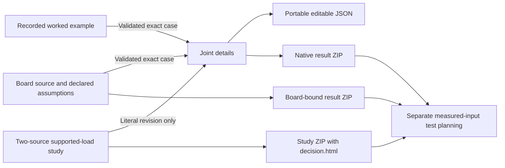

# Refinement grounding after the connected workflow

## Overview

SolderShape now has one navigable investigation. The Board explorer supplies a real lower-pad source. Joint details computes editable held-gap or supported-load cases. Pad comparison asks a separate two-revision height question. Worked example provides recorded force contrasts, and Physical test supplies the matching outside-lab package.

The next useful refinement is making the calculation understandable and portable. Adding another board or a new solver does not address the current gaps. A user can retain exact inputs and numerical receipts today, but the main result pages still require them to translate units, interpret force signs, and explain the exported evidence themselves. The report below describes source inspection and small local checks. Root owns browser verification.

The checkout was clean at `11379f8` when this investigation started. No relevant memory entry was found. Application code, historical evidence and released archives were left unchanged.

## Key concepts

- `soldershape.case.v1` stores footprint text, a selected pad index, one vertical condition, other numeric parameters, and optional reference diameter and volume. The Python parser derives lower diameter from the selected source pad. It rejects caller-supplied lower diameter and a simultaneous gap and load.
- A browser draft retains raw input strings. Empty and temporarily invalid values can survive navigation. Drafts contain no forces, meshes, native receipts or authorization token. Session storage is not durable project storage.
- A calculation is an immutable input snapshot. Each page increments its revision after edits and rejects late responses. Fresh computation is required after restoring a draft or opening a transferred case.
- `refinement_checked` means the numerical calculation passed the current checks. `not_converged`, `failed` and `model_warnings` remain distinct states. Physical force accuracy remains unqualified in all states.
- A Board request adds a trusted source board and component selection to an ordinary case. Its evidence ZIP retains that binding. Opening its copied geometric case in Joint details does not transfer board-bound evidence.
- A Study contains two source footprints, boundary evidence, a declared gap requirement, shared supported load and optional effective metal-cylinder mapping. Its effective-domain mesh is not a physical solder surface. Three analytical volume points are not a tolerance interval.

## How it works

`soldershape/web/ui.js` creates a common five-destination header, current-page marker, product promise and footer. It also owns bounded session storage and short-lived case transfer. `openCase` validates through `/api/case` before writing a handoff. Joint details validates it again before replacing the current draft, preserving one prior draft when storage permits. Existing recovery actions handle unavailable storage, imports and explicit replacement without a browser backup.

Each page keeps its own state and rendering. The common script uses an IIFE and exposes one `SolderShapeUI` namespace because page scripts have colliding global bindings. The server remains a stdlib loopback HTTP server with a fixed GET allowlist. POST requests require the same-origin token. Native operations share a computation lock.

The Board page uses micrometers and nanoliters for process inputs. `board.js` divides those values by 1000 before constructing the millimeter and cubic-millimeter request. A default 400 µm upper pad, 300 µm gap, 240 µm offset and 40/56 nL volumes become `0.4`, `0.3`, `0.24` and `0.04/0.056` in Joint details. The latter page shows only millimeter and cubic-millimeter units. Transfer is numerically correct, but the visual continuity ends at the unit conversion.

Board and Worked example render the same `demo.screen_pair` objective. The screen requires restoring lateral force and no upward separating force at a held gap. Numerical failure or model warnings block the preference. Joint details instead renders signed forces and a technical comparison delta. It has no equivalent plain-language result summary and applies both held-gap and supported-load requests. Reusing the held-gap fixture objective for a supported-load result would be incorrect.

`artifacts.make_bundle` writes exact inputs, result JSON, CSV, editable source, checksums, native receipts and meshes. `board.bundle_board` adds source-board binding and source identities. Neither includes a readable result brief. `study.bundle_study` already adds a standalone `decision.html` with inputs, conclusion, limits and next actions. This makes the Study export easier to review outside the application than the other two important exports.

## Where things live

| File | Responsibility relevant to this refinement |
| --- | --- |
| `soldershape/web/ui.js` | Common navigation, input drafts, file-ready link and checked case transfer. |
| `soldershape/web/board.html` and `board.js` | Micrometer and nanoliter fields, actual-pad context, record origin, shared fixture screen and board evidence. |
| `soldershape/web/index.html` and `app.js` | Millimeter inputs, reference setup, selected result, numerical checks, comparison delta, sweep and generic result export. |
| `soldershape/web/study.html` and `study.js` | Distinct criterion-driven revision study and literal-rim transfer. |
| `soldershape/__main__.py` | Normalization, `calculate_comparison`, API authorization and native compute routes. |
| `soldershape/model.py` | Strict numerical ranges, immutable specs, trusted selected-pad diameter and case format. |
| `soldershape/demo.py` | Existing held-gap fixture rule and recorded example. |
| `soldershape/artifacts.py` | Generic result ZIP and immutable archive reader. |
| `soldershape/board.py` | Exact board binding, code identity, checked board export and numerical replay. |
| `soldershape/study.py` | Existing readable decision brief and finite analytical samples. |
| `cohesion/RESULTS.md` | Prior tested continuity, source-loss repairs and remaining storage limitations. |
| `expansion/PRODUCT-ENDSTATE.md` | Investment boundary and required practitioner and physical evidence. |

## Gotchas

### 1. Unit continuity and accepted input ranges need one repair

The unit conversion is correct in `board.js` fields and `readDraft`. Joint details switches its input labels, reference recap, geometry caption and result table to mm and mm³. No conversion cue accompanies a transfer. This is an inferred comprehension risk from confirmed display values, not a measured user error. An inline engineering-unit equivalent or one consistent compact snapshot is smaller than changing canonical schemas or creating a configurable unit system.

There is also a confirmed validation disagreement. `board.html` accepts upper diameter and held gap from 1 µm with no maximum. The Python limits are 50 to 10000 µm for diameters and 20 to 10000 µm for gap. Offset has no browser bounds but is limited to ±5000 µm. Surface tension and density minima also differ. Every value below is HTML-valid and rejected by `board_case` in a local check.

| Field | UI-valid value | Actual rejection |
| --- | --- | --- |
| Upper diameter | 1 µm | `upper_diameter_mm must be between 0.05 and 10.0.` |
| Held gap | 1 µm | `standoff_mm must be between 0.02 and 10.0.` |
| Offset | 10000 µm | `offset_mm must be between -5.0 and 5.0.` |
| Surface tension | 0.0001 N/m | `surface_tension_n_m must be between 0.01 and 2.0.` |
| Density | 0.001 g/cm³ | `density_g_cm3 must be between 0.1 and 25.0.` |

The smallest decisive acceptance checks are to transfer the default 40/56 nL board case and identify the same geometry in both screens without arithmetic. Exact saved canonical values must remain unchanged. Enter 1 µm upper diameter and 1 µm gap. Each must fail visibly before a compute request. Test lower and upper accepted endpoints, negative offset and blank raw drafts. Invalid values must never appear as zero in a new recap.

### 2. Joint details needs an interpretation tied to the selected snapshot

`app.js:451` puts the selected force first, then numerical checks, then the comparison summary below the model. `app.js:525` reports a long signed delta sentence. The Board screen provides a direct outcome, but Joint details loses that explanation when the same user arrives to inspect or change the case. A signed force pair alone does not tell a user what the candidate changed or whether a conclusion is blocked.

Add one compact interpretation next to the result, using the existing comparison object and selected result. State the vertical condition and source pad with the actual result inputs. For a checked held-gap comparison, state the lateral-restoration change and whether a vertical sign changes. For a supported-load comparison, explain the solved gap difference. At zero offset, say that centering force cannot be compared. Preserve the distinction between interpretation, numerical checks and physical qualification.

The smallest decisive acceptance is to open and recompute the Board case. Its result takeaway must agree with the Board's forces and explicitly retain the held gap. Repeat with the aligned supported-load example. That result must discuss gap without invoking the no-upward-force fixture rule. Exercise a scope warning, numerical failure, no reference and a negative offset. Editing any input must remove both the previous interpretation and its snapshot. Selecting a sweep row must change the snapshot and explanation together.

### 3. Saved results need a readable, exact brief

I inspected the actual prior download archives. `cohesion/evidence/current-board.zip` contains only `BOARD-LICENSE.md` among top-level human-readable documents. `cohesion/evidence/board-to-joint-comparison.zip` has no such document. `cohesion/evidence/custom-study.zip` contains `decision.html`. The first two archives are reproducible but require code or spreadsheet inspection to understand the engineering question. This weakens the current value of keeping evidence for a colleague or outside lab.

A small offline HTML brief generated from the exact result report would close this gap. It should record source identity, the input assumptions with units, reference and candidate values, numerical status, retained failure or scope limit, force convention, interpretation, remaining measurement needs and replay instructions. Keep the original JSON, CSV, manifest and raw receipts. A new report editor, project database, cloud sharing service or PDF dependency is unnecessary.

The smallest decisive acceptance is to download a fresh Board comparison and ordinary Joint comparison through their visible browser links. Extract and open each brief without the server. The brief's every force, gap, volume, selected pad and status must match the ZIP's canonical JSON and CSV. The manifest must hash the brief. A failed case must contain no invented force or mesh. Source names and errors containing HTML must render as text. The current archive reader and numerical replay must still accept the new bundle. Preserve all older recordings and ZIP identities.

### Scientific and implementation constraints

- Do not claim that clearer text fixes the unresolved published-force discrepancy. The four published standoff comparisons provide limited evidence under a paper-specific geometry mapping. They do not qualify the force model or production pad selection.
- Do not turn the copied Board case into a claim that arbitrary changed Joint inputs are still the original board-bound result. The origin note is provenance of the copied starting point.
- Do not apply the held-gap fixture objective to the supported-load solver. Positive upward force is expected when balancing a downward load.
- Keep effective-cylinder Study geometry separate from literal-rim Joint geometry. Reuse the existing literal transfer.
- `board.py` hashes calculation-source files at load and export. Editing `__main__.py`, `artifacts.py` or `demo.py` requires a fresh server for fresh Board compute and export. UI-only changes can preserve numerical source identities.
- Historical recordings validate their archived source. New presentation must not rewrite them to make their code identities current.
- `read_bundle` has bounded membership, size and manifest checks. Adding a brief must preserve those checks and all existing portable files. Reuse its format instead of adding another archive schema.

Experience First prioritizes comprehensible units and results over more controls. Laziness Protocol keeps canonical units, existing cases and fixed routes. These choices leave the next maintainer a smaller change with explicit acceptance checks.
